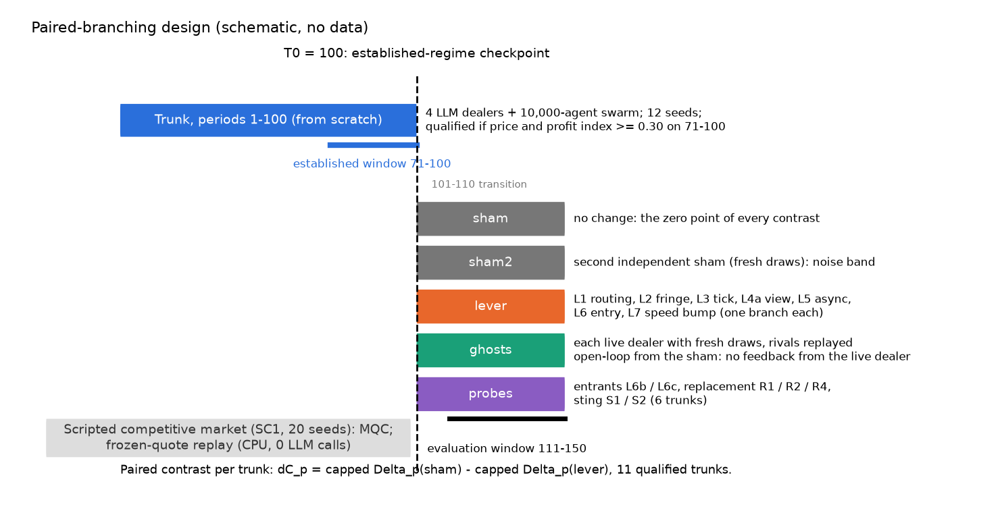
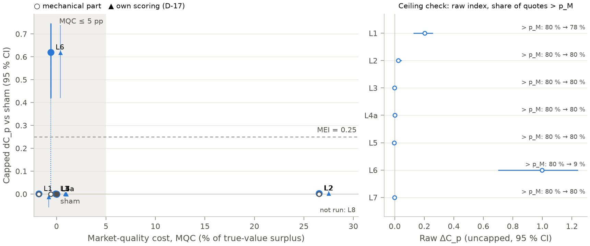
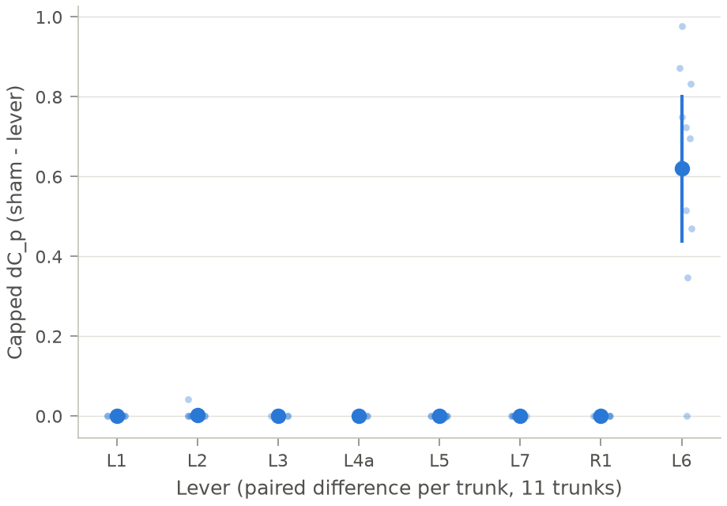
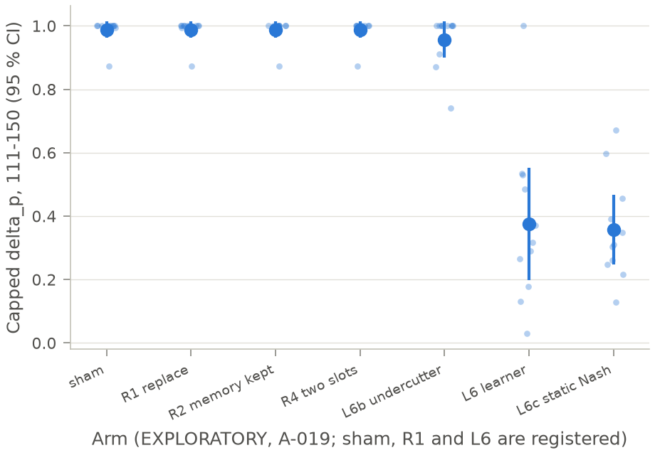
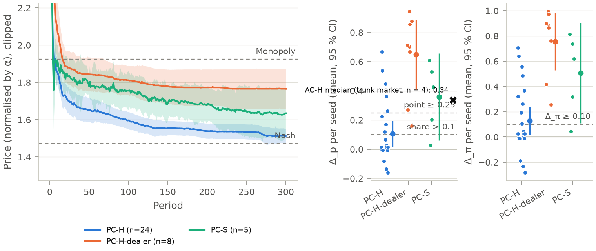
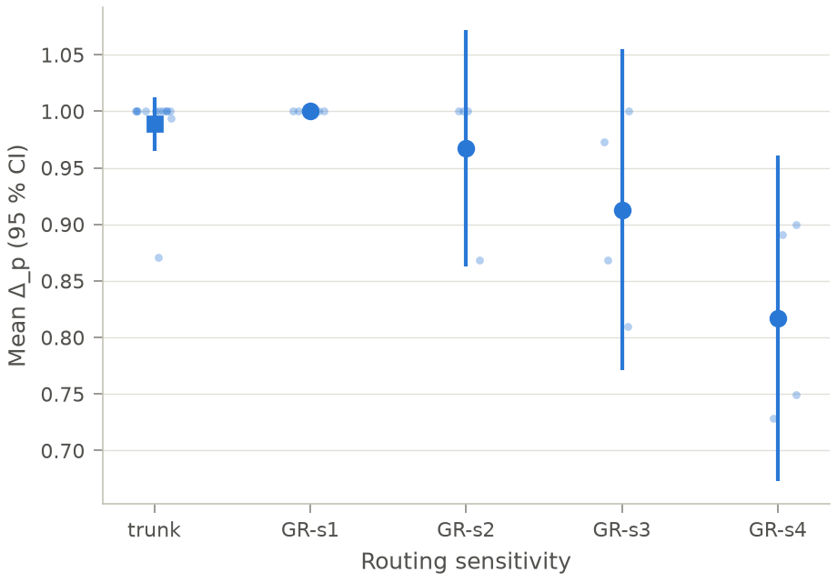
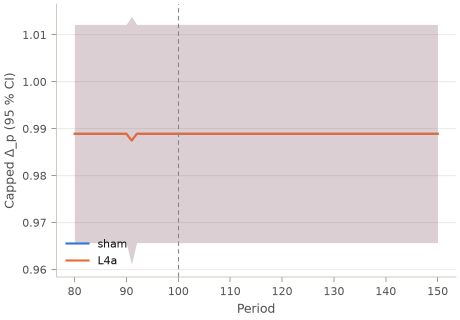

# Rules or Rivals? Paired Interventions on Entrenched Supra-Competitive Pricing by LLM Dealers

# Abstract

LLM pricing agents can sustain supra-competitive prices without exchanging messages, and a
regulator controls the market's rules, not the model. Once such prices are entrenched, what moves
them? In this testbed, four Claude Haiku 5.5 dealers post asks to a 10,000-agent order flow; in
11 markets with an entrenched supra-competitive focal-price regime [C3a], we apply one intervention
at a time to branches paired with sham controls. Six pre-registered rule changes (routing
sensitivity, a public fringe, tick size, an anonymised view, staggered updates, a speed bump) did
not bring asks below the monopoly price, and the primary hypothesis, the fringe, is not supported
[C3a] [C3b]. A seller posting a competitive price pulled asks to its own band (capped index 0.62,
Holm p < 0.001) at no measured efficiency cost [C3b] [C3c]. One model, one prompt and a scripted
entrant limit these findings.

# In 3 minutes

**Question.** Once LLM dealers settle on supra-competitive prices, what moves them, and at what
cost: the market's rules, or new competition?

**Testbed.** Four Claude Haiku 5.5 dealers, a 10,000-agent order flow, 11
markets in an entrenched focal-price regime [C3a]; each intervention is paired with a sham branch.

**Answer.** No rule change brought asks below the monopoly price (primary hypothesis not
supported) [C3a]. A seller posting a competitive price pulled asks to its own band (capped index
0.62, Holm p < 0.001) at no measured efficiency cost [C3b] [C3c].

**Limit.** One model, one dealer prompt, a scripted entrant with unlimited capacity. **Where to
look.** Table 2 and Fig. 2.

# 1 Introduction

Large language model (LLM) agents now set prices. In repeated posted-price games they reach
supra-competitive prices without exchanging a message (Fish et al. 2024); the outcome depends on
which models compete (Lee 2026) and on the prompt (section 4.1), and monitoring their reasoning is
reported to miss it (Lee and Park 2026). A regulator or an exchange does not control the model. It
controls the rules of the market and who may enter.

**Question.** Once LLM dealers have settled on supra-competitive prices without communicating,
what moves them, and at what cost to market quality: changes to the market's rules, or new
competition?

**Answer.** In this testbed, no change to the market's rules moved the dealers' asks below the monopoly price, and the primary hypothesis (the public fringe) is not supported. A seller posting a competitive price did move them, at no measured efficiency cost [C3b] [C3c]. Section 4 gives the evidence and Table 3 the menu.

**Gap.** Earlier work changes the model or the prompt, or applies interventions in separate runs.
Garra (2026) compares a prompt warning, a regulator and a random-price entrant with one provider,
no paired control and no cost measure; Keppo et al. (2026) vary patience, information and the
number of firms. Entry is therefore known to matter. We found no study that changes the market's
institution itself, mid-run, from the same checkpoint, against a sham control, with an efficiency
cost for each change.

**Approach.** Four Claude Haiku 5.5 dealers post asks to a 10,000-agent order flow; in 11 of 12
markets they settle on a common supra-competitive focal ask [C3a]. At period 100 we branch each
market, apply one intervention per branch and compare it with a sham branch, under a design
pre-registered and frozen in two stages.

**Contributions.** (1) An open hybrid testbed: LLM dealers, a 10,000-agent swarm, checkpoint
branching, sham and ghost controls, and scripted best responders that price each intervention.
(2) A paired, costed comparison of eight registered interventions from an established regime:
entry of a seller posting a competitive price pulls asks to its band; four rule changes leave asks
at the ceiling; sharper routing and the public fringe trim asks inside the supra-monopoly band;
batch auctions were not built. (3) Exploratory evidence on which kind of entry is enough and on
replacing incumbents. For an exchange or a regulator the outcome is a ranked menu of what each
intervention does, what it costs and when it works (Table 3).

# 2 Related Work

**LLM pricing agents.** LLM agents in a Bertrand-logit market (Calvano et al. 2020) reach
supra-competitive prices without communicating (Fish et al. 2024). Lee (2026) varies which models compete; we hold the agents fixed and vary the market's
rules. Agrawal et al. (2025) study LLM collusion in continuous double auctions, the institution our
fringe moves toward. Monitoring the agents' reasoning is reported to miss collusion (Lee and Park
2026).

**Interventions.** Garra (2026) evaluates a warning, a regulator and a random-price entrant in
independent runs, with no checkpoint pairing, a single provider and no efficiency cost. Keppo et
al. (2026) report in their abstract that more competing LLMs, or LLMs mixed with Q-learners, weaken
collusion; Anto and Vazquez (2026, ICML workshop) report in theirs that a regulator's veto brings
some models to the competitive benchmark. Collina et al. (2025) study in theory how to break
algorithmic collusion with agents that are not part of it, which motivates our no-regret entrant.

**Market design.** With learning algorithms, tick size (Cartea, Chang and Penalva 2022), dealer
liquidity provision (Cartea et al. 2022) and asynchronous updating (Conjeaud et al. 2026) have
been studied; in the field, Nasdaq dealers avoided odd-eighth quotes (Christie and Schultz 1994)
and the 1997 display of public limit orders changed trading costs (Barclay et al. 1999). We found
no study that applies both the market's rules and entry to LLM agents mid-run, from one
established-regime checkpoint, against paired shams, with a cost for each change (Table A1).

# 3 Methods

**3.1 Design.** The study runs in five steps (Fig. 1), reported in this order in section 4:
(1) check that the LLM dealer prices above the competitive level where benchmarks are known;
(2) let four LLM dealers price from scratch and keep the markets that settle above it; (3) from
one checkpoint of each such market, apply one change at a time against a sham branch that changes
nothing; (4) vary the entrant, replace incumbents, force a deviation; (5) measure what each change
destroys in a market that already competes. Every rule was registered before its data existed;
later additions are labelled exploratory (Appendix B).



**Fig. 1 (design; no data).** Paired-branching design. Four LLM dealers and a 10,000-agent swarm run 100 periods from scratch; at the checkpoint (period 100) each qualified market is branched into a sham, a second sham, one branch per intervention and no-feedback ghost markets, and every contrast is the paired difference of the capped price index over periods 111-150. Costs come from scripted competitive markets.

**3.2 Market.** Four posted-price dealers (one-sided quotes) each post an ask $p_i$ per period on
a grid from 1.00 to 4.00 (tick 0.05) at unit cost $c = 1$; there are no bids and dealers never
trade with each other. Buyers arrive from a background swarm of 10,000 agents, and a buyer with
valuation $v$ chooses dealer $i$ with probability proportional to $\exp((v - p_i)/\tau)$, an
outside option included. At $\tau = 0.25$ this routing reproduces the Bertrand-logit demand of
Calvano et al. (2020),
$$q_i(\mathbf p) = \frac{\exp((a - p_i)/\mu)}{\sum_{j=1}^{4} \exp((a - p_j)/\mu) + \exp(a_0/\mu)},
\qquad a = 2,\ a_0 = 0,\ \mu = 0.25,$$
so the market has two closed-form benchmarks: the static Nash price $p_N = 1.33$, at which no
dealer gains by changing its price alone, and the joint-profit maximum $p_M = 2.05$. Each dealer
is Claude Haiku 5.5 under `dealer_v1`, a lever-neutral adaptation of the Fish et al. (2024) prompt
that shows the last 76 to 100 rounds of asks and trades and answers in JSON (Appendix B).

**3.3 Regime and branching.** Twelve trunks (seeds 0-11) run 100 periods from scratch. A trunk
qualifies when its mean price index and mean profit index over periods 71-100 both reach 0.30
(the registered "collusion established" criterion); we call the state of a qualified trunk an
entrenched supra-competitive focal-price regime, or the regime (Appendix A). At period 100 each
qualified trunk $k$ is branched into a sham, a second sham, and one branch per intervention
(Table 1). All branches of a trunk share the background draws (common random numbers) and run to
period 150; outcomes are read on periods 111-150. Intervention branches keep the trunk's request
seeds, so a dealer whose prompt matched the sham's would receive the sham's cached answer; the
cost ledger shows this never happened
(0 of 2200 post-branch decisions per lever or replacement branch were
served from the sham's cache) [C13]. The second sham and the
ghosts draw fresh answers by construction of their seeds.

**3.4 Estimand.** With $\bar p$ the mean ask of the four incumbent LLM dealers (entrants excluded),
the price index is $\Delta_p = (\bar p - p_N)/(p_M - p_N)$: 0 at the Nash price, 1 at the
joint-profit maximum; the profit index $\Delta_\pi$ is defined in the same way from mean profit
per dealer. The registered price index is capped, $\tilde\Delta_p = \min(\Delta_p, 1)$,
because asks above $p_M$ lose sales and earn less. For intervention $\ell$ and trunk $k$,
$$d_{\ell k} = \tilde\Delta_p(\text{sham}_k) - \tilde\Delta_p(\ell_k), \qquad
\Delta C_{p,\ell} = \frac{1}{K}\sum_{k=1}^{K} d_{\ell k},$$
so a positive $\Delta C_{p,\ell}$ means lower asks; the estimand is the mean effect among markets
in which the regime formed. It is scored against the trunk's benchmarks (primary) and the
intervention market's own, and the uncapped (raw) contrast is reported beside it; since $p_M - p_N = 0.723$, a raw contrast $x$ is a price change of $0.723x$. The cost
of $\ell$ is its market-quality cost (MQC): the percentage of total surplus that $\ell$ destroys
in a scripted market whose dealers post their static best response to the rivals' last asks,
against the sham, over 20 paired seeds (formula in Appendix B).

**3.5 Hypotheses and decision rules.** H1, the pre-specified primary, is that the public fringe
L2 lowers the capped index: $H_0: \mathbb E[d_{L2,k}] \le 0$, rejected by a one-sided paired
t-test at $\alpha = 0.05$ under both scorings, with $\mathrm{MQC}_{L2} \le 5$ %. H1-R applies the
same test to the eight registered levers with Holm adjustment ($m = 8$); L8 was not built and
enters with $p = 1$. Family S (Holm, $m = 8$) holds the secondary hypotheses (Appendix C).
Equivalence margins are $\pm 0.20$ for H1 and H1-R and $\pm 0.15$ in family S. Intervals are BCa
bootstrap intervals over trunks. Planned power was 0.88 with 12 trunks; 11 qualified. Because the
capped sham-sham2 differences have no variance, the per-trunk differences, exact sign tests and
raw contrasts are the primary display (A-024, exploratory) and the equivalence tests are in
Appendix D. The full rules are in Appendix B.

**Table 1. Interventions, all applied at period 100.** L1-L8 form H1-R; R1, R3, S1-S2 and L9
belong to family S; L6b, L6c, R2 and R4 are exploratory (A-019).

| Id | Intervention | Change at period 100 |
| --- | --- | --- |
| L1 | Routing sensitivity | $\tau$: 0.25 -> 0.0625 (more price-sensitive buyers) |
| L2 | Public limit-order fringe | each arriving buyer becomes a fringe seller with probability 0.30 |
| L3 | Finer tick | 0.05 -> 0.01 |
| L4a | Anonymised quote view | rival quotes shown without identities |
| L5 | Staggered updates | each dealer revises at random times, one period apart on average |
| L7 | Speed bump | every quote takes effect 3 periods after it is posted |
| L8 | Frequent batch auctions | not built |
| L6 | Maverick entry | a no-regret seller (EXP3 over 31 prices) joins |
| L6c / L6b | Other entrants | posts $p_N$ and never reacts / posts 0.05 below the best rival ask |
| R1 / R2 / R4 | Replacement | one dealer by a fresh copy, memory erased / kept; two dealers |
| R3 | Cross-family replacement | one dealer by `ministral-8b` |
| L9 | Monitoring notice | dealers are told the market is monitored |
| S1 / S2 | Sting | one dealer forced to raise / cut its ask (6 trunks) |

All entrants are scripted, make no LLM call, have no capacity limit and cannot be bought out.

# 4 Results

All results hold in this testbed: one model under one dealer prompt, 11
markets [C3a], asks without bids or inventory, and scripted entrants with unlimited capacity that
enter at a fixed date (Appendix F). In the sham branches 80 % of quotes
sit above $p_M$, so the capped index registers a cut only when it brings asks below $p_M$ [C10].

## 4.1 Step 1: the instrument

The dealer prompt, not the Fish et al. prompt, elicits supra-competitive prices from Haiku 5.5.
Under the Fish prompt the duopoly kept little of the markup (price index
0.107, 95 % interval [0.042, 0.200];
8 of 24 runs above 0.10): the replication failed [C1]. Under the
dealer prompt, in the same two-firm closed-form market, the price index was
0.65 ([0.42, 0.80]) and the
profit index 0.76 [C1b] (Fig. A1), so the interventions ran on that prompt,
as registered. Supra-competitive pricing therefore depends on the prompt, a property of the
instrument rather than a finding (Appendix B). Against three scripted best responders a single LLM
dealer settles at a median index of 0.34 [C1c]: the prompt alone
does not hold asks above $p_M$.

## 4.2 Step 2: the regime

Four LLM dealers settle on a common supra-competitive ask and keep it. Of 12 trunks screened,
11 qualified; the excluded trunk (seed 8) priced highest and failed the profit
criterion, so every estimate is conditional on regimes that persisted from the opening quote
[C3a] (opening-quote cache hits: Appendix B). This is the regime of section 3.3: a common round-number ask, in most markets
above the joint-profit maximum, that dealers rarely undercut. Rivals answer a forced undercut only
partially and the deviation stays profitable (6 of 6 probes)
[C13], so the regime is consistent with tacit coordination on a focal price, not with joint-profit
maximisation; the data do not separate strategic restraint from inertia (Appendix C).

## 4.3 Step 3: what moves the regime

Entry lowered incumbent asks; no rule change brought them below $p_M$.

**Table 2. Interventions against the sham of the same trunk (11 trunks,
periods 111-150, trunk scoring).** At 0: trunks with a capped difference of exactly zero. Raw:
uncapped contrast (a registered reported quantity) with 95 % BCa interval; sign p: exact sign test
on the raw differences (exploratory, A-024). MQC: % of surplus lost in competitive scripted
markets (negative = gain). Holm: H1-R, m = 8. L6c and L6b are exploratory (A-019).

| Intervention | $\Delta C_p$ capped | At 0 | Raw $\Delta C_p$ [95 %] | Sign p | Quotes > $p_M$ | MQC (%) | Holm p |
| --- | --- | --- | --- | --- | --- | --- | --- |
| Sham | 0 | | | | 80 % | 0 | |
| L1 routing sensitivity | 0.001 | 10 | 0.202 [0.126, 0.259] | < 0.001 | 78 % | -1.78 | 1 |
| L2 public fringe (H1) | 0.003 | 9 | 0.025 [0.010, 0.048] | 0.011 | 80 % | 26.53 | 1 |
| L3 finer tick | 0.001 | 10 | -0.001 [-0.006, 0.002] | 0.938 | 80 % | -0.11 | 1 |
| L4a anonymised view | 0.000 | 11 | 0.000 [-0.002, 0.001] | 0.500 | 80 % | 0.00 | 1 |
| L5 staggered updates | 0.000 | 10 | -0.003 [-0.008, -0.001] | 1 | 80 % | 0.00 | 1 |
| L7 speed bump | 0.000 | 11 | -0.002 [-0.007, 0.000] | 1 | 80 % | 0.00 | 1 |
| L8 batch auctions | not built | | | | | | 1 |
| L6 no-regret entrant | 0.620 | 1 | 0.998 [0.699, 1.241] | < 0.001 | 9 % | -0.58 | < 0.001 |
| L6c Nash-price entrant | 0.633 | 0 | 1.049 [0.883, 1.201] | < 0.001 | 1 % | n.m. | expl. |
| L6b pegged undercutter | 0.033 | 8 | 0.153 [0.113, 0.186] | < 0.001 | 74 % | n.m. | expl. |

n.m. = not measured. Sources: [C3a] [C3b] [C3c] [C10] [C11] [C12] [C13].



**Fig. 2 (confirmatory, H1-R).** Effect against cost for six market-rule changes and one entry, from the checkpoint: capped price-index reduction versus the sham (trunk scoring, 11 trunks, 95 % intervals) against the market-quality cost in competitive scripted markets; filled circle = total, open circle = mechanical part, triangle = own scoring; the right panel gives the raw contrast and the share of quotes above p_M. Reading: only entry (L6) brings asks below the monopoly price, at no measured cost; the fringe's cost is demand removed by design.



**Fig. 3 (exploratory display, A-024; registered H1-R contrasts).** Capped price-index difference, sham minus intervention, per trunk (one dot each, mean and 95 % interval), 11 trunks, periods 111-150. Reading: the six rule changes leave 9 to 11 of 11 trunks at exactly zero; entry moves 10 of 11.

**Entry.** Entry of a no-regret seller is the only registered intervention that survives Holm
(1 of 8): $\Delta C_p$ = 0.62 (95 % interval
[0.42, 0.75], Holm p < 0.001; own
scoring: Holm p < 0.001; split-sample estimate in Appendix C) [C3b] [C11]. The capped index
fell in 10 of 11 trunks; the raw contrast,
1.00, is a price fall of about 0.72, and quotes
above $p_M$ fell from 80 % to 9 % [C12]. The
incumbents remain 0.34 index points ([0.15,
0.54]) above their static best response to the entrant (exploratory)
[C13]: entry pulls asks to the entrant's price band, above the Nash price (Figs. 2 and 4).

**Rule changes.** No rule change moved the capped index (Holm p = 1 each; exactly zero in
9
to
11
of 11 trunks, Fig. 3) [C3b] [C12]. On the raw index they split in two. Sharper
routing (L1) lowered asks by about 0.15 (exploratory sign test, p
< 0.001), close to the fall of its own monopoly price (2.05 to
1.92), with 78 % of quotes still above $p_M$ [C12]: a
competitive adjustment inside the supra-monopoly band. The tick, the anonymised view, staggered
updates and the speed bump left asks at the ceiling, with raw contrasts within
0.003
of zero [C12]. These levers act on price changes, and here prices do not change: the nulls show
that they do not dislodge a static focal price, not how they would act on a punishment phase or a
price war, and they are not an artefact of shared answers (section 3.3). Equivalence tests are in
Appendix D.

**H1, the pre-specified primary.** We registered the expectation that the fringe would lead, as a
step from a dealer market toward a double auction. Read after the result, the demand model
explains why it did not: turning a share of arriving buyers into sellers scales logit demand down
at nearly every price, which leaves each dealer's static best response almost where it was, and the
scripted best responders do not move (mean ask 1.35 in the sham,
1.35 with the fringe) [C3c]. Neither do the LLM dealers: $\Delta C_p$ =
0.003 (one-sided p = 0.208 trunk scoring, p
= 0.255 own scoring; 95 % lower bound -0.004), zero in
9 of 11 trunks [C3a] [C12]. H1 is not supported. On the
raw index the fringe trims asks by 0.025 ([0.010,
0.048]; exploratory sign test p = 0.011) [C12] [C13].

## 4.4 Step 4: what entry needs

A competitive price, posted durably, is what moved asks; who the incumbents were did not matter.
In the exploratory entrant comparison (A-019; Fig. 4), a seller that posts the Nash price and never
reacts (L6c) lowered the capped index by 0.63
([0.53, 0.72]), close to the learner; the
difference, 0.014 ([-0.15,
0.15]), is not an equivalence [C13]. An undercutter pegged 0.05 below the
best rival ask (L6b) lowered it by 0.03 ([0.01,
0.07]) [C11]: it never posts a competitive price and can only follow the
incumbents down. Incumbents price near the entrant's average ask, 0.33
and 0.84 above their static best response [C13]; price level and
strategy were not varied independently, so the comparison does not say which of the two matters.
Replacing one incumbent by a fresh copy, with or without memory, or two incumbents, left the
regime in place (H7-same supported under its registered rule; Appendix C) [C6] [C11].



**Fig. 4 (exploratory, A-019).** Capped price index of the incumbents, periods 111-150, for the sham, three replacement variants and three entrants (no-regret learner, static Nash-price seller, undercutter pegged to the rivals); registered arms: sham, R1, learner. Reading: a durably posted competitive price pulls asks to the entrant's band; a pegged entrant does not.

## 4.5 Step 5: cost

The interventions that moved prices cost nothing in a market that already competes: the entrant
raises total surplus by 0.58 % and sharper routing by 1.78 %, and
the other rule changes change it by at most 0.11 %, except the fringe, whose
26.5 % is demand removed by design [C3a] [C3c] (Fig. 2). The secondary hypotheses and
the robustness arms are consistent with this picture (Appendix C), and the registered detection
test is a negative result (Appendix E). Table 3 summarises each lever's effect, cost, evidence
grade and condition.

**Table 3. What each intervention does in this testbed.** Effect: capped $\Delta C_p$ (trunk
scoring); raw: uncapped contrast; cost: MQC (%, negative = gain). Grade A: registered confirmatory
test with Holm; B: registered, no change detected on the capped index (equivalence tests in
Appendix D), not "proven useless"; C: exploratory (A-019), no decision rule.

| Intervention | Effect below $p_M$ | Raw effect | Cost (%) | Grade | Condition |
| --- | --- | --- | --- | --- | --- |
| L1 sharper routing | 0.00 [C3b] | 0.20, asks stay above $p_M$ [C12] | -1.78 [C3c] | B on the capped index; raw trim not equivalent (exploratory) | |
| L2 public fringe | 0.00 [C3a] | 0.02 [C12] | 26.53, demand removed by design [C3a] | B; H1 not supported | the fringe converts buyers into sellers |
| L3 finer tick | 0.00 [C3b] | 0.00 [C12] | -0.11 [C3c] | B | |
| L4a anonymised view | 0.00 [C3b] | 0.00 [C12] | 0.00 [C3c] | B | |
| L5 staggered updates | 0.00 [C3b] | 0.00 [C12] | 0.00 [C3c] | B | tested on flat prices only |
| L7 speed bump | 0.00 [C3b] | 0.00 [C12] | 0.00 [C3c] | B | tested on flat prices only |
| L9 monitoring notice | equivalent within $\pm 0.15$, TOST p < 0.001 [C9] | | not measured | B (H10 not evaluable) | |
| Replacement R1 (R2, R4) | equivalent within $\pm 0.15$, TOST p < 0.001 [C6] (0.00, 0.00 [C11]) | | not measured | B (R1); C (R2, R4) | |
| L6 no-regret entrant | 0.62, Holm p < 0.001 [C3b] | 1.00 [C12]; 0.34 [0.15, 0.54] above the static best response [C13] | -0.58 [C3c] | A | durable entry only: unlimited capacity, no buy-out (absorption excluded by design) |
| L6c static Nash-price entrant | 0.63 [C11] | 1.05 [C12] | not measured | C | durable entry only: unlimited capacity, no buy-out (absorption excluded by design) |
| L6b pegged undercutter | 0.03 [C11] | 0.15 [C12] | not measured | C | pegged to the incumbents' asks |
| L8 batch auctions | not built | | | none | |

# 5 Discussion

**What the regime is.** In most markets the common ask sits above the monopoly price, so it is not
a joint-profit optimum. A forced undercut stayed profitable in all six probes, rivals followed
only part of it, and in hindsight the dealers forgo about 60 % of attainable profit [C13]. We read
the regime as a focal convention sustained by non-undercutting with weak enforcement; the data do
not separate strategic restraint from inertia, and the round opening ask is the model's own choice
under this prompt, not a value we set.

**Why the rule changes did not bring prices down.** The tick, the anonymised view, staggered
updates and the speed bump act on price changes, and here prices do not change. The fringe removes
demand instead of adding competition: under logit demand a proportional loss of buyers leaves the
best response where it was, and the scripted best responders did not move either [C3a] [C3c].
These nulls say that the levers did not dislodge a static focal price; they say nothing about a
punishment phase, a price war or other learning agents.

**What entry did.** A competitive price posted durably moved asks. In the exploratory comparison a
seller fixed at the Nash price moved them about as much as the learner [C11], and the incumbents
stayed above their static best response [C13]; price level and strategy were not varied
separately. For a regulator the lever is contestability (Table 3), on one condition: entry must be
durable. Our entrants have unlimited capacity and cannot be bought out, so absorption, a familiar
response in real markets, is excluded by design.

**Detection.** The detection evaluation set (2 positive, 26 negative windows) is too small to tell
a detector from chance, so we make no detection claim [C8].

**Perspectives.** Several follow-ups remain untested. Applying each rule from the opening period
or at earlier checkpoints, rather than to an installed regime, would test whether market design acts on the formation of the
regime rather than on its persistence. Letting incumbents buy out the entrant, or capping the
entrant's capacity, would test whether entry still moves asks when it is not durable, and how much
entry a regulator needs. Varying the number of incumbents would test whether the regime depends on
market concentration. A second model family that keeps the output format would test whether the
regime belongs to one model and one prompt or to LLM dealers in general.

# 6 Conclusion

**Answer to the question.** In this testbed, LLM dealers that had settled on a supra-competitive focal price were not brought below the monopoly price by six pre-registered changes to the market's rules, and the primary hypothesis, the public fringe, was not supported. They were moved by a seller that posted a competitive price (capped index 0.62, Holm p < 0.001), at no measured efficiency cost [C3b] [C3c]. For a regulator or an exchange the evidence favours contestability over rule design, provided entry is durable; replacing an incumbent by a fresh copy did not help.

**Limits.** One model under one dealer prompt, 11 markets, posted asks without inventory, and a scripted entrant with unlimited capacity: the result does not say how a real entrant would behave.

**Next.** An entrant with limited capacity, a second model family that keeps the output format, and a two-sided market with inventory.

# Code and Data; Author Contributions; References

**Code and data.** The engine, configurations, prompts, analysis code, run manifests and the
figure and table sources are in the repository `fin-agent-collusion-swarm` (tag
`v0.1-weekend`). Every run has a manifest with its configuration hash, seed, git commit,
prompt hashes and model identifiers. Reproduction, from the repository root:

```bash
uv sync --frozen
uv run pytest -q                                     # engine and analysis tests (mock provider)
uv run python scripts/check_prereg.py --strict       # frozen stage and PREREG.sha256 over the hashed set
uv run python scripts/analyze.py --gates --campaigns-root results/campaigns \
    --gate1 PC-H --gate1b PC-H-dealer --gate2 TR-H --anchoring AC-H
uv run python scripts/analyze.py results/campaigns/TR-H      # registered analysis of a campaign
uv run python scripts/verify.py paper/numbers.json --report results/analysis/verify_report.json
```

`scripts/verify.py` re-derives every number of `paper/numbers.json` from the raw logs without the
engine's code.

**Pre-registration.** `docs/03_preregistration/` holds the pre-registration, the analysis plan,
the detection protocol, the campaign table and the append-only amendment log. `PREREG.sha256` lists
one SHA-256 per hashed file. Stage 1 (90 files: documents, configurations, prompts) was frozen at
2026-10-10T08:40:57Z, tag `prereg-freeze` (commit `1b02071`); stage 2 added the analysis and
metrics code, and the hashed set reached 122 files with amendment A-022 (`FROZEN` records every
step).

**Corpus.** `docs/06_corpus/` holds the codebook and the labelling sheets of the scratchpad corpus
used for the judge validation; the key to the blind labels is kept outside the repository.

**Costs.** Actual LLM spend: 170.6 USD, within a hard cap of 200 USD (cost ledger; planned and
actual calls, parse failures and exclusions per campaign in Table B0).

**Reproduction map.** Each claim tag of the text, the campaigns behind it (run-id prefix of the
manifests in `results/manifests/`), the analysis output that `paper/numbers.json` copies, and the
display that shows it.

| Claim | Campaigns (run-id prefix) | Analysis output | Display |
| --- | --- | --- | --- |
| C1, C1b, C1c | `PC-H-alpha`, `PC-H-dealer`, `AC-H` | `results/analysis/gates/gates.json` | Fig. A1 |
| C2 | `GR-H-tau`, `TR-H__` | `results/analysis/family_s/family_s.json` | Fig. A2, Table C1 |
| C3a | `TR-H--sham__`, `TR-H--L2__`, `SC-1--L2` | `results/analysis/TR-H/stats.json`, `gates/gates.json` | Table 2, Fig. 2 |
| C3b, C4 | `TR-H--sham__`, `TR-H--L1__` ... `TR-H--L7__`, `TR-H--L9__` | `results/analysis/TR-H/stats.json` | Table 2, Figs. 2-3 |
| C3c | `SC-1--sham`, `SC-1--L1` ... `SC-1--L7` | `results/analysis/SC-1/mqc.json` | Table 2, Fig. 2 |
| C3m | `TR-M` | `results/analysis/TR-M/stats.json` | Table C1 |
| C-S | `TR-S` | `results/analysis/TR-S/stats.json` | Table C1 |
| C5 | `TR-H--L4a__`, `TR-H--sham--ghost` | `results/analysis/TR-H/stats.json`, `family_s/family_s.json` | Fig. A3, Table C1 |
| C6 | `TR-H--R1__`, `TR-H--R3__` | `results/analysis/family_s/family_s.json` | Table C1 |
| C7 | `TR-H--S1__`, `TR-H--S2__`, `CA-H` | `results/analysis/family_s/family_s.json` | Table C1 |
| C8 | `TR-H--S2__`, `TR-H--sham--ghost`, `CA-H` | `results/analysis/detection/report.json`, `corpus_v1/kappa.json` | Appendix E |
| C9 | `TR-H--L9__` | `results/analysis/family_s/family_s.json` | Table C1 |
| C10 | `TR-H--sham__`, levers | `results/analysis/TR-H/stats.json` | Table D1 |
| C11 | `TR-H--L6__`, `TR-H--L6b__`, `TR-H--L6c__`, `TR-H--R2__`, `TR-H--R4__` | `results/analysis/TR-H/stats.json` | Table 2, Fig. 4 |
| C12 | `TR-H--sham__`, `TR-H--sham2__`, levers | `results/analysis/TR-H/stats.json`, `a6_coherence.json` | Table 2, Fig. 3, Appendix D |
| C13 | `TR-H__`, `TR-H--R1__`, `TR-H--S2__`, entrants | `results/analysis/a024_exploratory.json` | Section 4.2, Appendix C |

**Author contributions.** Clément Barbier set the question, designed the study, wrote and froze
the pre-registration, ran the experiments, labelled the judge-validation corpus, set the wording
rulings, reviewed the final version and takes responsibility for every claim; Claude Code
drafted the text, which the author did not rewrite (LLM Usage Statement). This is independent work inspired by the Apart AI Collusion Research Sprint, not
conducted at the sprint; the engine was built during the same weekend as the experiments.

**References**

- Agrawal, Teo, Vazquez, Kunnavakkam, Srikanth, Liu (2025). Evaluating LLM Agent Collusion in
  Double Auctions. arXiv:2507.01413. `agrawal2025`
- Anto, Vazquez (2026). Oversight is Not Compliance: Tacit Collusion in LLM Pricing Agents Under
  Antitrust Regulation. ICML 2026 workshop (Agents in the Wild). `antovazquez2026`
- Barclay, Christie, Harris, Kandel, Schultz (1999). Effects of Market Reform on the Trading Costs
  and Depths of Nasdaq Stocks. Journal of Finance 54(1), 1-34. `barclay1999`
- Calvano, Calzolari, Denicolò, Pastorello (2020). Artificial Intelligence, Algorithmic Pricing,
  and Collusion. American Economic Review 110(10), 3267-3297. `calvano2020`
- Cartea, Chang, Mroczka, Oomen (2022). AI-driven liquidity provision in OTC financial markets.
  Quantitative Finance 22(12). `cartea2022dealers`
- Cartea, Chang, Penalva (2022). Algorithms and Supracompetitive Prices in Electronic Markets: The
  Impact of Tick Size. SSRN 4105954. `cartea2022tick`
- Christie, Schultz (1994). Why Do NASDAQ Market Makers Avoid Odd-Eighth Quotes? Journal of
  Finance 49(5), 1813-1840. `christie_schultz1994`
- Collina, Arunachaleswaran, Jagadeesan (2025). Breaking Algorithmic Collusion in Human-AI
  Ecosystems. arXiv:2511.21935. `collina2025`
- Conjeaud, Abel, Kalogeratos (2026). Algorithmic collusion under asynchronous price updating.
  arXiv:2608.01406. `conjeaud2026`
- Fish, Gonczarowski, Shorrer (2024). Algorithmic Collusion by Large Language Models.
  arXiv:2404.00806 (ACM EC 2026). `fish2024`
- Garra (2026). Mitigating Emergent Collusion in LLM Pricing Agents. arXiv:2609.13037.
  `garra2026`
- Keppo, Li, Tsoukalas, Yuan (2026). On the Fragility of AI Agent Collusion. arXiv:2603.20281.
  `keppo2026`
- Lee (2026). Who Leads and Who Collects: Algorithmic Collusion in Markets of Heterogeneous
  Language Models. arXiv:2610.11256. `lee2026`
- Lee, Park (2026). Faithful yet Collusive: Why Chain-of-Thought Monitoring Cannot Detect Collusion
  in LLM Pricing Agents under Oligopolistic Competition. Findings of EMNLP 2026, arXiv:2609.18346.
  `leepark2026`

# LLM Usage Statement

LLMs are the object of study: Claude Haiku 5.5 as the market's dealers; Claude Sonnet 5.5 as a
capability arm and as the scratchpad judge on Haiku runs; Mistral `ministral-8b` and
Llama-3.3-70B (through OpenRouter) as second-family dealers. Claude Code served as an engineering
and analysis assistant: it drafted simulation code, analysis scripts and figure code, and checked
claims against logs.

Claude Code drafted every section of this report, including the Abstract, Introduction,
Discussion and Conclusion, at the author's request; the author did not rewrite the drafted text and
reviewed the final version. The author set the question, the design, the hypotheses and the wording
rulings, and takes responsibility for every claim. No sentence of this report is claimed to be hand-written. All hypotheses,
decision rules and thresholds were written and frozen by the author before data collection; later
changes are logged as amendments (Table B1). Every result number in the text is drawn from
`paper/numbers.json`, whose values `scripts/verify.py` re-derives from the raw logs; design
parameters come from the frozen configurations.

# Appendices A-E

## A. Double glossary and closest work

Each term is defined once; the second sentence gives the plain reading.

*Market terms, for readers from AI safety.*

- **Bertrand-logit market.** Sellers set prices and buyers split among them by a logit choice rule
  (section 3.2). Buyers lean toward cheaper sellers without all switching at once.
- **Static Nash price ($p_N$).** The price at which no seller gains by changing its own price
  alone in the one-shot game. It is the competitive reference.
- **Joint-profit maximum ($p_M$).** The common price that maximises the sellers' total profit.
  It is what a perfect monopolist would charge; asks above it earn less, not more.
- **Static best response.** The price that maximises a seller's profit given its rivals' last
  prices. It is what a myopic profit-maximiser does.
- **Maverick entry.** Entry of a seller that does not follow the incumbents' pricing convention.
  It is a newcomer that does not go along with the existing norm.
- **Reward-punishment.** A strategy that keeps prices high while rivals do and cuts them after a
  rival undercuts. It is conditional cooperation enforced by retaliation, the mechanism usually
  meant by tacit collusion.
- **Market-quality cost (MQC).** The percentage of total surplus an intervention destroys in a
  market that already competes. It is the collateral damage of a remedy applied to an innocent
  market.
- **Focal price; entrenched supra-competitive focal-price regime.** A focal price is a price that
  sellers converge on without agreement because it stands out (here a round number); the regime is
  a common round-number ask, in most markets above the joint-profit maximum, that dealers adopt
  from their opening quote and rarely undercut. It is the state every intervention starts from.
- **Price index, profit index.** The mean incumbent ask (or profit) rescaled so that 0 is the
  static Nash level and 1 the joint-profit maximum. It reads as the share of the monopoly markup
  the sellers keep.
- **Capped and raw index.** The capped index stops at 1; the raw index does not. Above $p_M$ the
  capped index cannot see a price cut, the raw index can.
- **Trunk scoring, own scoring.** The index of an intervention branch computed with the trunk's
  benchmarks, or with the benchmarks of the market as the intervention changes it. The second
  separates a change of conduct from a change of the competitive price itself.

*Agent and design terms, for readers from finance.*

- **Posted-price dealer (one-sided quotes).** An LLM agent that posts one ask per period and sells
  at it. There are no bids and no spread.
- **Scratchpad.** The free-text plans and insights an agent writes and reads back in later
  periods. They are its only memory beyond the market history.
- **No-regret learner; ex-post regret.** A learning rule (here EXP3) whose average profit
  approaches that of the best fixed price in hindsight, whatever the rivals do; ex-post regret is
  the share of that attainable profit not earned. The learner adapts without a model of the others.
- **Sham, second sham, ghost.** A sham is a branch from the same checkpoint with no change; the
  second sham repeats it with fresh LLM draws; a ghost re-runs one dealer against its rivals'
  recorded asks. They are the placebo, the noise floor and the no-feedback counterfactual.
- **Trunk, checkpoint, branch.** A trunk is a market run from scratch to period 100; the
  checkpoint is its saved state at period 100; a branch restarts from the checkpoint with one
  change. Every arm of a trunk shares the same history up to the change.
- **Paired design; common random numbers.** Each intervention is compared with the sham of the
  same trunk, on the same background draws. Differences then reflect the intervention, not luck.
- **Holm adjustment.** A step-down correction that keeps the chance of any false rejection among
  m tests at 5 %. With eight levers, a lever must clear a stricter bar than a single test.
- **BCa interval.** A bootstrap confidence interval corrected for bias and skewness, here
  resampling trunks. It does not assume normal differences.
- **Equivalence test (TOST).** Two one-sided tests that an effect lies inside a margin (here
  $\pm 0.20$). It supports "no meaningful difference", not merely "no significant difference".
- **Minimum effect of interest.** The smallest effect worth detecting: 0.25 for the H1 and H1-R
  levers, where it fixes the power calculation only (their equivalence margin is $\pm 0.20$), and
  0.15 in family S, where it is also the decision threshold and the TOST margin. It is the effect
  size the design is built around.

**Table A1. Closest work.** Cells state only what the cited source reports.

| Study | Agents | Intervention | Timing and pairing | Cost axis |
| --- | --- | --- | --- | --- |
| Garra 2026 | one LLM provider, Fish-style market | warning, regulator, random-price entrant | independent runs; entrant present in every period | none |
| Keppo et al. 2026 | LLM pricers, Bertrand-logit | number and mix of agents (abstract) | composition fixed by design | none stated |
| Cartea, Chang, Penalva 2022 | reinforcement-learning dealers | tick size | design comparison | none stated |
| Barclay et al. 1999 | Nasdaq dealers (field) | display of public limit orders | before and after a rule change | trading costs, depth |
| This study | four LLM dealers, one-sided asks | six rule changes and three entrant types | mid-run from a common checkpoint, paired with two shams | surplus in a competitive scripted market |

## B. Design details

**Dealer protocol.** `dealer_v1` keeps the Fish et al. (2024) P1 prefix, market facts and line
formats verbatim, lists past rounds from the oldest down, and hides inventory and cash; it mentions no
synchrony, so the timing levers do not contradict it. The history window keeps the last 76 to 100
rounds and drops the oldest 25 at once when it would exceed 100, identically in every arm.
Requests use `effort: low`, `max_tokens` 2048 and no temperature setting. An unparseable answer
gets up to 3 repair attempts (registered bound: 10), after which the dealer keeps its previous ask and the decision is
flagged; a run with more than 10 % failed or flagged decisions is excluded.

**Gates.** Gate 1 replicates Fish et al. with their prompt in the closed-form duopoly (300
periods, 8 seeds at each of $\alpha$ = 1, 3.2, 10). It passes if the mean price index over periods
251-300 has a 95 % interval excluding 0 and a point estimate of at least 0.25, the profit index
reaches 0.10, at least 60 % of runs exceed 0.10, and fewer than 5 % of decisions fail to parse.
Gate 1b applies the same criteria to `dealer_v1` in the same duopoly ($\alpha$ = 1, 8 seeds). The
registered consequence of "fails Gate 1, passes Gate 1b" is that the interventions run on
`dealer_v1` and the replication is reported as failed. AC-H puts one LLM dealer against three
scripted static best responders in the four-dealer market (4 seeds). The trend rule would have
moved the checkpoint to period 120 had the cross-trunk price index still been rising over periods
81-100 by more than 0.005 per period. The prompt matters as much as the model: Sonnet 5.5 under the
Fish prompt reached 0.36 ([0.14,
0.52]; descriptive, 5 runs) [C1]. In the four-dealer swarm market,
scripted best responders settle at 1.35, against the closed-form
$p_N = 1.33$ [C3c].



**Fig. A1 (confirmatory).** Positive controls: price paths (left), Delta_p and Delta_pi per run (right) for Haiku 5.5 under the Fish prompt (24 runs), Haiku 5.5 under the dealer prompt (8 runs) and Sonnet 5.5 under the Fish prompt (5 runs), duopoly, periods 251-300, prices normalised by alpha, dashed lines at the Nash and monopoly prices and at the Gate 1 thresholds; the AC-H marker (median 0.34) is a Delta_p on the four-dealer market. Reading: the same model prices near Nash under one prompt and keeps about two thirds of the markup under the other.

**Table B0.** Lanes, planned versus actual calls, parse failures, exclusions and USD per campaign from the cost ledger. Reading: costs per decision exceeded the sizing (Sonnet +92 %, Haiku +71 %); no instrument run was excluded.

| Campaign | Lane | Model | Planned calls | Actual LLM decisions | Provider calls (ledger) | Runs planned / done / failed / excluded | Parse-failure rate (n) | Repairs | Refusals | USD (ledger) | USD per decision |
| --- | --- | --- | --- | --- | --- | --- | --- | --- | --- | --- | --- |
| PILOT-H | H | claude-haiku-5-5 | 20 | 20 | 20 | 1 / 1 / 0 / 0 | 0.00 % (0) | 0 | 0 | 0.0098 | 0.000492 |
| PILOT-S | S | claude-sonnet-5-5 | 20 | 20 | 20 | 1 / 1 / 0 / 0 | 0.00 % (0) | 0 | 0 | 0.1275 | 0.006374 |
| PC-H | H | claude-haiku-5-5 | 14,400 | 14,400 | 14,998 | 24 / 24 / 0 / 0 | 0.12 % (18) | 523 | 0 | 12.92 | 0.000897 |
| PC-H-dealer | H | claude-haiku-5-5 | 4,800 | 4,800 | 4,801 | 8 / 8 / 0 / 0 | 0.00 % (0) | 1 | 0 | 2.83 | 0.000590 |
| PC-S | S | claude-sonnet-5-5 | 3,000 | 3,000 | 3,069 | 5 / 5 / 0 / 0 | 0.00 % (0) | 69 | 0 | 46.88 | 0.015626 |
| PC-M (relaunch, A-004) | M | ministral-8b-latest | 14,400 | 0 persisted (running) | 1,511 | 24 / 0 / 0 / 0 (24 running at snapshot, 0 periods checkpointed) | n.a. | 0 | 0 | 0 (free lane) | n.a. |
| PC-M (discarded, A-004) | M | ministral-8b-latest | (same 14,400) | 1,500 | 7,987 | 24 started / 0 / 24 discarded (A-004: max_tokens 600 truncated the JSON output) / n.a. | 66.27 % (994) | 1,299 | 0 | 0 (free lane) | n.a. |
| AC-H | H | claude-haiku-5-5 | 400 | 400 | 400 | 4 / 4 / 0 / 0 | 0.00 % (0) | 0 | 0 | 0.2089 | 0.000522 |
| TR-H (trunks only) | H | claude-haiku-5-5 | 4,800 | 4,800 | 4,801 | 12 / 12 / 0 / 0 (s8 not qualified at Gate 2, Delta_pi 0.281 < 0.30; not an exclusion) | 0.00 % (0) | 1 | 0 | 2.56 | 0.000534 |
| **Total (rows above)** | | | 41,840 | 28,940 (incl. 1,500 discarded PC-M) | 37,607 | | | | | 65.54 | |
| branches (SH-H, SH2-H, levers, ghosts) | | | | | | not tabulated before stage-2 freeze | | | | | |

**Decision rules.** H1: one-sided paired t-test of $H_0: \mathbb E[d_{L2,k}] \le 0$ at
$\alpha = 0.05$ under each scoring, no multiplicity adjustment; supported only if both scorings
reject and $\mathrm{MQC}_{L2} \le 5$ %; a reduction under the trunk scoring only is "a price
reduction consistent with competitive adjustment"; practical significance if the one-sided 95 %
lower bound exceeds 0.10; Wilcoxon signed-rank as a sensitivity check; if neither scoring rejects,
TOST within $\pm 0.20$. H1-R: the same test for L1-L8, Holm ($m = 8$) within each scoring, a lever
not run entering with $p = 1$. Best lever: among levers with MQC at most 5 % (upper bound at most
7 %), the largest capped contrast on odd-seed trunks, estimated on even-seed trunks. Family S:
Holm ($m = 8$); "at least" hypotheses test $H_0: \mu \le$ MEI, "less than" hypotheses use a TOST
with margin MEI = 0.15; for a joint rule the larger component p enters Holm. The market-quality
cost is
$$\mathrm{MQC}_\ell = \frac{1}{20}\sum_{s=1}^{20} 100\,\frac{TS_s(\text{sham}) - TS_s(\ell)}{TS_s(\text{sham})},$$
with $TS_s$ the total surplus at true valuations over periods 111-150 in the scripted best-responder
market of seed $s$.

**Controls.** The second sham's request seeds are salted so that none of its answers come from the
response cache; it measures the noise of fresh LLM draws. Ghost markets re-run each live dealer
from period 100 with fresh draws against its rivals' sham asks replayed open-loop, so any coupling
they show cannot come from feedback. Before period 100 the branches of a trunk are identical;
16 of the 48 opening trunk decisions were served from the response cache, so trunk openings are not all independent draws. A frozen-quote replay re-scores the sham's asks in each
intervention's market and gives the mechanical part of each contrast.

**What did not work.** Under the Fish prompt Haiku 5.5 did not pass Gate 1 (section 4.1).
Mistral's `ministral-8b` failed the JSON output format and was dropped as the second family before
any outcome (A-005); its replacement, Llama-3.3-70B, qualified too few trunks to evaluate H1-M. The
`ministral-8b` newcomer of the cross-family replacement arm (R3) failed more than 10 % of its
decisions and was excluded. The registered fringe converts buyers into sellers and therefore
removes demand instead of adding outside liquidity. L8 was never built. The registered analysis
was re-run after commit d132839 with the final arm registry (255 runs analysed); numbers.json and
every figure come from that re-run, committed at 4196a12. The S1c-LLM-TR-H arm (3 runs)
reused the S2 runs' cached answers after the checkpoint
(597 of 597
post-branch decisions, ledger join) [C7] and ran on
qualified trunks; it is excluded from H8 (A-026). The H8 competitive side uses the CA-H S1c runs.

**Pre-registration and amendments.** The pre-registration, analysis plan, detection protocol,
configurations and prompts were hashed before any data (stage 1: 90 files, tag `prereg-freeze`);
the analysis and metrics code was hashed before any intervention outcome was read (stage 2).
Amendment numbers A-001 to A-024 were used; A-017 and A-023 were never assigned and A-020 was
withdrawn before data (A-021). Table B1 lists them with the data seen before each change; times are
git commit times (UTC), which supersede the hand-typed times inside the entries (some are off by one
to two hours; reconciliation table in `AMENDMENTS.md`). Entries that changed no hashed file have no
hash line. The A-019 parameter correction was hashed at 16:39Z, before the L6b and L6c campaigns
ran; the "18:20Z" typed in its entry is a typo. The blind pass was not effectively blind: the
blinded output carried each lever's MQC and printed the H1 line (A-012).

**Table B1. Amendments to the registered set (stage-1 freeze: 10 Oct 08:41Z).** Entry: commit that added the
entry; Hash: `FROZEN` line(s) re-hashing the registered file set. Times UTC, 10 Oct unless stated.

| Id | Change | Entry | Hash | Data seen before | Effect |
| --- | --- | --- | --- | --- | --- |
| A-001 | Stage-2 hash of analysis and metrics code | 9 Oct 18:40 | 13:18 | gates and scripted costs; no intervention outcome | registered |
| A-002 | Sonnet arm truncated for cost | 09:22 | none | cost ledger | registered |
| A-003 | L2 labelling rule (dual benchmark, scripted ask-fall bound) | 10:27 | none | benchmarks and gates | registered |
| A-004 | Mistral `max_tokens` 600 -> 2048 | 10:31 | 10:32 | ledger rows | registered |
| A-005 | Mistral dropped; second family Llama-3.3-70B, reduced scope | 11:39 | 12:56 | call and parse statistics | registered |
| A-006 | Garra (2026) wording | 11:16 | 11:16 | none relevant | wording |
| A-007 | Gate 2 read before the cost runs existed (deviation recorded) | 11:51 | none | gate outputs | deviation |
| A-008 | Period labels mapped to engine periods | 12:54 | none | gate outputs | correction |
| A-009 | MQC(L2) reading; per-buyer surplus added | 12:54 | none | scripted controls | exploratory measure added |
| A-010 | Verifier recomputes exclusions; sting test degrees of freedom | 14:37 | 14:37 | H1, H1-R | correction |
| A-011 | Figure and verifier code | 15:57 | 15:57 | all registered results | code |
| A-012 | Robustness lever resolved (L2 + L6); blind pass not effectively blind | 13:31 | 13:35 | blinded contrasts, H1 line | disclosure |
| A-013 | Ghost-arm registry match | 13:58 | 13:59 | H1, H1-R | correction |
| A-014 | Detection split and corpus sampler | 14:10 | 14:21, 14:26, 14:43 | H1, H1-R; no detection output | registered |
| A-015 | Gradient s1 runs matched (12 -> 16) | 14:18 | 14:24 | preliminary H2 | correction |
| A-016 | Sting label match; H7-other reads R3 | 15:16 | 15:20 | family S | correction |
| A-017 | Not assigned (holds a correction to A-016: the R3 newcomer is `ministral-8b`) | 17:57 | none | family S | correction |
| A-018 | Sting follow count read from the event payload | 15:36 | 15:36 | no H8 value | correction |
| A-019 | Entrant types L6b and L6c, replacement R2 and R4, ghost false-positive check | 16:14 | 16:14, 16:39, 17:37 | registered results; no L6b, L6c, R2, R4 data | exploratory |
| A-020 | Prevention block | 16:24 | 16:24 | registered results | withdrawn by A-021 before data |
| A-021 | Withdraws A-020 | 16:30 | none | none | withdrawal |
| A-022 | Reporting fields: raw contrast, sign counts, ceiling panel | 18:28 | 18:28 | every result | reporting |
| A-023 | Not assigned (reserved for a Sonnet L6 branch, withdrawn) | 11 Oct 01:53 | none | every result | none |
| A-024 | Diagnostics (replacement, entry best response, undercut probes); sign tests primary, TOST to Appendix D | 18:53 | none (code outside the hashed set) | every result | exploratory |
| A-025 | `verify.py` reads Parquet through polars when pyarrow cannot load (environmental) | 11 Oct 04:57 | none | every result | none (same values) |
| A-026 | S1c-LLM-TR-H arm excluded from H8 (cache replay of S2) | 11 Oct 05:47 | none | every result | exclusion |

## C. Secondary hypotheses and robustness

**Table C1. Family S (Holm, m = 8) and the robustness arms; capped index, trunk scoring.**

| Hypothesis | Registered test | Result | Verdict |
| --- | --- | --- | --- |
| H2 routing gradient, from scratch | Spearman $\rho < 0$ and s1 - s4 $\ge 0.30$ | $\rho$ = -0.74 (permutation p = 0.001); gap 0.17 | not supported |
| H4 finer tick | $\Delta C_p \ge 0.15$ | 0.001 | not supported |
| H5 asynchrony | $\lvert \Delta C_p \rvert \ge 0.15$ | 0.000 | not supported |
| H6 identity-bearing quotes | $\Delta C_p(L4a) \ge 0.15$ and dependence falls | 0.000 | not testable: no dependence in the sham |
| H7-same replacement | equivalence within 0.15; recovery within 20 periods | TOST p < 0.001 | supported |
| H7-other cross-family newcomer | $\Delta C_p \ge 0.15$ | newcomer excluded | not testable |
| H8 sting | follow-rate gap $\ge 0.30$ | 0.00 vs 0.00 | not supported |
| H10 monitoring notice | equivalence within 0.15; dependence stable | TOST p < 0.001 | not evaluable (dependence condition) |
| H-S Sonnet 5.5, L2 | one-sided paired t | 0.010, p = 0.094 | no significant reduction |
| H1-M second family (Llama-3.3-70B), L2 | one-sided paired t | 0.034, p = 0.012, on 2 of 6 trunks | not evaluable: below the registered minimum of 3 |

Sources: [C2] [C4] [C5] [C6] [C7] [C9] [C-S] [C3m].

From scratch, more price-sensitive routing lowers the price index (Fig. A2), but the gap between
the least and most sensitive levels (0.17) falls short of the registered 0.30
[C2]; this agrees with L1 trimming asks inside the supra-monopoly band. Under the anonymised view
the price index stays at the ceiling through the checkpoint (Fig. A3). The forced rise of the
sting was followed in no market, collusive or competitive (H8) [C7]; since asks already sit above
$p_M$, where a profit-maximising dealer would not follow a rise either, this null does not bear on
coordination. The registered response flag after a forced undercut fired in
5 of the 6 probed trunks [C7]. The A-024 diagnostics (exploratory)
describe that response [C13]: rivals lowered their asks by 0.11
index points on average over the three following periods, against a gap of
1.01 between their pre-probe ask and their static best response, and the
deviator earned more than in the sham in 6 of 6 probes (by
11.9 per period over ten periods, against a per-dealer profit of 20.1
at $p_M$). Both comparisons are confounded by the starting level: from asks above $p_M$ a cut
raises profit even if rivals match it, and the static best response lies far below the pre-probe
ask before any cut. They show a partial response, not the absence of enforcement. The incumbents'
ex-post regret (0.60
to 0.65 of
attainable profit) is computed against the best fixed price in hindsight [C13]. With Sonnet 5.5 dealers the fringe
also leaves the capped index near zero [C-S]. The second-family contrast,
0.034 (p = 0.012) on 2 of 6 trunks, is below the
registered minimum of 3 trunks: not evaluable, shown for transparency only [C3m].

**Best lever.** Selected on odd-seed trunks and estimated on even-seed trunks, the best lever is
L6, with a split-sample estimate of 0.62
([0.45, 0.77]) [C3b].

**Replacement.** Replacing one incumbent by a fresh copy with its memory erased (R1) left the
capped index equivalent to the sham within the family-S margin $\pm 0.15$ (TOST p
< 0.001; Holm p = 0.003), so H7-same is supported under its registered
rule [C6]; the test has degenerate variance, because the index never left the ceiling, and the
recovery condition held trivially. The copy's opening ask tracks the incumbents' period-100 ask
(slope 0.89, R-squared 0.96; exploratory, A-024) [C13];
since the regime's price is close to a fresh dealer's default opening in most trunks, this does not
separate learned coordination from the default. Keeping the memory (R2) or replacing two dealers
(R4) left the capped index at the sham's level (0.000 and
0.000; exploratory) [C11]. The cross-family newcomer (R3,
`ministral-8b`) failed the output format on more than 10 % of its decisions and was excluded, so
H7-other is not testable.



**Fig. A2 (confirmatory, H2).** Capped Delta_p of incumbent dealers from scratch at four routing levels (tau 0.25, 0.125, 0.0625, 0.02), periods 71-100, pooled s1 (trunks and CRN runs) and CRN-paired runs, with 95 % intervals. Reading: the index falls with routing sensitivity (Spearman rho -0.74 over 16 runs, permutation p 0.001; `paper/numbers.json`) but the s1-s4 gap (0.17) does not reach the registered 0.30.



**Fig. A3.** Capped Delta_p around the checkpoint (period 100) for the sham and for the anonymised view (L4a), mean and 95 % interval across trunks (H6 not testable: no dependence in the sham). Reading: the two series coincide at 0.99 through the checkpoint, so the anonymised view leaves asks at the ceiling.

## D. Equivalence tests

The capped sham-sham2 differences are zero in every trunk, so the capped TOSTs have degenerate
variance and are reported for completeness only. The raw sham-sham2 difference has a standard
deviation of 0.0085 [C12]. On the raw index, with the registered margin
$\pm 0.20$, the TOST p-values are: L2 < 0.001, L3 < 0.001, L4a
< 0.001, L5 < 0.001, L7 < 0.001, and L1
0.522: routing sensitivity's raw effect sits on the margin and is not
equivalent to zero [C12]. Staggered updates raised raw asks slightly
(-0.003 [-0.008, -0.001]) [C12]. These raw
TOSTs and the sign tests are exploratory (A-024). The margin
$\pm 0.20$ is registered for H1 and H1-R, where 0.25 served only for power; family S uses its
minimum effect of interest, 0.15, as the margin (Table C1). Where a null rests on very few
non-zero trunks we call it undetermined rather than equivalent: L1, L3 and L5 are non-zero in
1, 1 and 1 trunk
each, L2 in 2, while L4a and L7 are zero in every trunk
(11 and 11 of 11) [C12].

PREREG also lists, next to every contrast, the profit contrast $\Delta C_\pi$, its mechanical and
behavioural parts, the benchmark shift, the trade-weighted price and the minimum detectable effect
at the realised N. For L2 the profit contrast is 0.010 and the
trade-weighted price 2.32 [C10]; Table D1 gives the profit
contrast, its mechanical part and the benchmark shift for every lever. The profit contrast is not
the registered measure because the levers move its benchmarks: under L1 its mechanical part alone
exceeds the total. With the raw sham-sham2 standard deviation, the minimum raw effect detectable
with 80 % power at N = 11 is 0.007 [C12], so the raw nulls of L3, L4a, L5 and
L7 are tight.

**Table D1. Registered reported quantities per lever (11 trunks, periods 111-150).** Profit
contrast $\Delta C_\pi$ (sham minus lever, per-window benchmarks, which the levers move), its
mechanical part from the frozen-quote replay, and the shift of the market's own benchmarks
($p_N$, $p_M$) under the lever. Descriptive; no decision rule.

| Lever | $\Delta C_\pi$ | Mechanical part | Shift of $p_N$ | Shift of $p_M$ |
| --- | --- | --- | --- | --- |
| L1 routing | 0.334 | 0.502 | -0.248 | -0.132 |
| L2 fringe | 0.010 | -0.396 | 0.006 | -0.004 |
| L3 tick | 0.003 | 0.000 | 0.000 | 0.000 |
| L4a anonymised view | 0.001 | 0.000 | 0.000 | 0.000 |
| L5 staggered updates | 0.004 | 0.000 | 0.000 | 0.000 |
| L7 speed bump | 0.003 | 0.000 | 0.000 | 0.000 |
| L6 no-regret entrant | 0.406 | 0.657 | -0.020 | 0.043 |

Source: [C10].

## E. Detection (H9): a negative result

Nine detectors (price level, dispersion, cross-correlation, Granger causality and transfer entropy
netted against ghost markets, net influence, gap to the static best response, active probes, and a
scratchpad judge) were calibrated at a 5 % false-positive rate on a development half of seed
groups, frozen and hashed, then evaluated once on the held-out half. On that half the composite
detector's AUC was 0.38 and its ghost false-positive rate
17 %, against registered bars of 0.85 and 5 % [C8]. The decision set
(2 positive and 26 negative windows) cannot distinguish a good detector from chance, so we make
no claim of detector performance. Two reasons are visible. Dependence detectors have nothing to
measure in a regime whose prices do not move. The scratchpad judge agreed poorly with the author's
blind labels (weighted kappa 0.13 on 60 windows, against the
registered 0.60) [C8], so it stayed outside the
composite; reasoning-trace monitoring is reported to miss collusion in LLM pricing agents (Lee and
Park 2026).

# Appendix F. Limitations

**Threats to validity.** Six features of the design bound every result. (i) *The ceiling.* The
regime we study is a common round-number ask that dealers adopt from their opening quote and that
sits above the joint-profit maximum, so our evidence concerns what moves an entrenched
supra-competitive focal price, not what dissolves an optimised, punishment-sustained scheme.
Because 80 % of sham quotes sit above p_M, the registered capped index
cannot register cuts that stay above p_M; the raw contrasts show that routing sensitivity lowers
asks by about 0.15, in line with the fall of its own monopoly price,
the fringe trims them by about 0.02, and the other four rule changes
leave them at the ceiling [C10] [C12]. (ii) *One model family.* All lever results come from Claude
Haiku 5.5; Mistral failed the output format and Llama qualified too few trunks, so cross-model
robustness is untested,
and the Sonnet 5.5 arm is the same provider at a larger size. (iii) *One dealer prompt.* The
dealers see their rivals' quotes under one prompt, adopted after the Fish et al. prompt failed to
elicit supra-competitive prices in Haiku 5.5. (iv) *Eleven markets.* The estimand is conditional:
the effect of an intervention in the 11 of 12 markets where the regime formed
and persisted; the entrant-type and replacement comparisons are exploratory, on the same trunks,
with the entrant's price level not varied independently of its strategy. (v) *A scripted entrant
with unlimited capacity.* The entrant enters at a fixed date into an already-formed regime, cannot
run out of supply and cannot be bought out, and the incumbents never trade with each other. The
design therefore excludes absorption, in which incumbents buy the entrant's cheap supply and
restore the high ask, a well-known response in real markets: our result shows that a durably
posted competitive price makes incumbents accommodate, not that a capacity-limited or acquirable
entrant would. (vi) *One-sided posted prices without inventory.* There are no bids, so there is
no bid-ask spread, no inventory risk and no adverse selection; the order flow is a synthetic swarm
and there are no human traders.

**Other limitations.**

- The registered fringe converts arriving buyers into sellers. It removes demand rather than
  adding outside liquidity, so it does not test the display of existing limit orders.
- Costs are measured in scripted competitive markets, not in the LLM markets, and L8 (frequent
  batch auctions) was never built.
- Live LLM answers are fresh draws after the checkpoint. The second sham measures that noise, but
  some period-0 trunk decisions were served from the response cache (Appendix B).
- Prevention is not tested: the only from-scratch evidence is the routing gradient (H2); the
  planned prevention block was withdrawn before any data (A-020, A-021).
- The detection evaluation set is too small to assess detectors, and the scratchpad judge is not
  validated (Appendix E).
- The blind pass was not effectively blind (A-012), and every amendment after the freeze is
  tabulated with the data seen before it (Table B1).
- The engine and the experiments were built and run by one author over one weekend.

# Appendix G. Dual-Use and Ethical Considerations

**Scope.** Everything here is a simulation: synthetic order flow, scripted controls and LLM
dealers that trade nothing real. We make no claim that LLM agents sustain supra-competitive prices
in any market today. The results describe one testbed and are meant for those who design and
supervise markets.

**Risks and mitigations.**

| What could help coordination | What could hinder detection | Mitigation |
| --- | --- | --- |
| The list of rule changes that left asks at the ceiling (tick, anonymised view, staggered updates, speed bump) could be read as a list of safe designs | The detectors' frozen thresholds are public and could be evaded | Detectors are published with their negatives and their false-positive rates; the detection result is reported as negative, not as a working audit |
| A regime that forms from a default opening ask shows how little coordination effort supra-competitive pricing may need | The sting probes are recognisable once described | No prompt optimised for coordination is released; `dealer_v1` is a lever-neutral adaptation of a published prompt |
| An entrant that could be exhausted or bought out might be absorbed by incumbents, restoring the high ask | | We state that a fragile low-price entrant is not shown to be a remedy: the result concerns durable entry, with capacity and no buy-out |

**Responsible use.** The intervention menu is framed as a defensive tool for exchanges and
regulators, with its cost beside each effect. The corpus of labelled scratchpad windows is
released with its codebook, and the key to the blind labels stays outside the repository. No
human subjects took part; the only human labels are the author's own.
